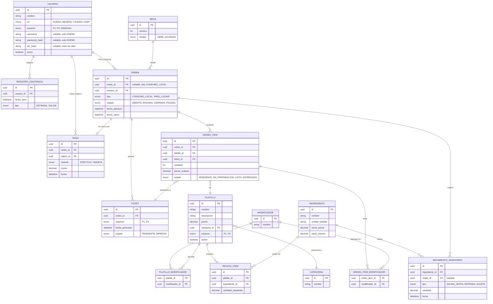

# Diseño: Sistema POS para Restaurante (punto-de-venta)

## 1. Intención y contexto

Este proyecto es un sistema de punto de venta (POS) construido desde cero para un
restaurante con mesas y comandas, como ejercicio de práctica para portafolio. El
objetivo no es solo que funcione, sino demostrar un modelo de datos relacional
real, manejo de roles/autenticación distintos, y un flujo de negocio con reglas
propias de una operación real (no un CRUD genérico).

El negocio modelado tiene una particularidad: la cocina está dividida en dos
estaciones físicas separadas por piso, pero el cobro se centraliza en un único
punto. El sistema debe reflejar esa separación sin complicar al usuario final.

**Repositorio:** https://github.com/Crisomber/punto-de-venta (público, aún sin
código — este documento se trabaja localmente hasta que se decida integrarlo).

## 2. El negocio

- Restaurante con **~15 mesas numeradas**, sin plano fijo (lista/selección simple).
- Dos estaciones de cocina:
  - **P1**: pizza y hamburguesas/alitas (dos cocineros, mismo espacio físico).
  - **P2**: taquería, en otro piso.
- Un único punto de cobro: **Caja P1**, sin importar qué estación preparó el
  platillo.
- El ayudante de cocina de P1 es también quien cobra (rol de cajero).

## 3. Roles y necesidades

| Rol | Autenticación | Necesidad principal |
|---|---|---|
| **Dueño** | Usuario + contraseña | Administrar menú, precios, inventario y ver reportes de venta que nadie más puede ver. |
| **Mesero** | PIN (registra asistencia) | Tomar la orden en mesa rápido, sin fricción, y cerrar la cuenta. |
| **Cajero P1** (ayudante de cocina) | PIN (registra asistencia) | Cobrar cuentas cerradas y registrar el método de pago. |
| **Chef P1 / Chef P2** | PIN (registra asistencia) | Ver solo los tickets que les corresponden, sin mezclarse con la otra estación. |

Chef P1 y Chef P2 no son tanto "usuarios que operan el sistema" como **destinos**
donde llega un ticket — una pantalla por estación que muestra lo pendiente para
ella. El PIN ahí sirve principalmente para registrar asistencia del cocinero en
turno, no para una gestión compleja de permisos.

## 4. Flujo operativo

1. El mesero inicia sesión con su PIN (esto registra su llegada).
2. Selecciona una mesa de la lista.
3. Arma la orden: agrega platillos, marca si es **para consumir en el
   establecimiento o para llevar** (debe quedar visualmente resaltado), y para
   cada platillo puede activar modificadores predefinidos (ej. sin cebolla, sin
   cilantro, sin mayonesa, sin verdura) desde un panel junto al ítem — **no**
   como una pregunta secuencial.
4. Al enviar la orden, el sistema la divide en **un ticket por estación**: si la
   mesa pidió pizza, hamburguesa y tacos, P1 recibe un ticket con pizza +
   hamburguesa, y P2 recibe un ticket solo con los tacos.
5. Cada estación ve en pantalla únicamente sus tickets pendientes (la impresión
   térmica física queda para la fase 2, ver sección 7).
6. Mientras la mesa sigue abierta, se pueden **agregar más platillos** a la
   misma orden después del primer envío (ej. piden postre o una bebida más
   tarde). Cada platillo agregado genera un **ticket nuevo solo con lo que se
   acaba de pedir** en la estación correspondiente (P1 o P2) — no se
   reimprime la comanda completa.
7. El mesero cierra la cuenta de la mesa y la envía a Caja P1.
8. El cajero de Caja P1 cobra y registra si fue efectivo o tarjeta (sin
   procesar el pago realmente, solo el dato). **En este momento** —al
   cobrarse, no al enviarse a cocina— el sistema descuenta automáticamente el
   stock de los ingredientes de todos los platillos de la orden, según su
   receta. Así, una orden cancelada antes de pagarse no deja el inventario
   descuadrado.
9. Al cobrar también se genera el **ticket de Caja**: a diferencia de los
   tickets de P1/P2 (que solo muestran lo de su estación), este es el recibo
   **completo y consolidado** con todos los platillos de la orden.

## 5. Menú e inventario

- El dueño define **platillos**: nombre, precio, categoría, estación (P1/P2) y
  qué modificadores están disponibles para ese platillo.
- Cada platillo tiene una **receta**: una lista de ingredientes y la cantidad
  que consume por unidad vendida.
- Los **ingredientes** se registran con unidad de medida, stock actual y un
  stock mínimo.
- Cada venta genera un movimiento de inventario que descuenta el stock según la
  receta del platillo vendido.
- Cuando un ingrediente cae por debajo de su stock mínimo, el sistema debe
  poder señalarlo (alerta/indicador visible para el dueño).

Esto corresponde a un patrón estándar de la industria: cada platillo tiene una
"receta digital" dentro del POS, y el sistema descuenta los ingredientes
automáticamente después de cada venta usando esa receta
([abcpos.com](https://www.abcpos.com/post/how-to-manage-restaurant-inventory-with-a-pos-system)).

## 6. Reportes (exclusivos del dueño)

- Total vendido (con rango de fechas seleccionable).
- Platillos más vendidos.
- Desglose por método de pago (efectivo vs. tarjeta).
- Ticket promedio (venta total entre cuentas cerradas).
- Ningún otro rol tiene acceso a esta información.

## 7. Alcance

### Dentro del alcance (MVP)

- Autenticación dual: usuario/contraseña (dueño) y PIN (resto del personal),
  con registro de asistencia al iniciar sesión con PIN.
- Gestión de mesas (lista numerada, estado libre/ocupada).
- Toma de órdenes con modificadores por ítem y tipo de orden (local/para
  llevar).
- Enrutamiento de comandas por estación de cocina (P1/P2), visibles en
  pantalla por estación.
- Cobro centralizado en Caja P1 con registro de método de pago (efectivo/
  tarjeta) como dato, sin pasarela real.
- Gestión de menú (platillos, precios, categorías, estación, modificadores).
- Inventario con recetas y descuento automático de stock por venta, con aviso
  de stock bajo.
- Reportes de venta exclusivos del dueño.

### Fuera de alcance por ahora (no descartado, solo no es MVP)

- **Impresión física en impresoras térmicas**: serán **3 impresoras** — una en
  P1 y otra en P2, que imprimen únicamente los alimentos/bebidas de su propia
  estación (incluyendo las reimpresiones parciales cuando se agregan
  platillos después del primer envío), y una en **Caja**, que imprime el
  ticket **completo y consolidado** de toda la orden al momento del cobro.
  Mientras no se tenga el hardware, los tickets se muestran en pantalla; la
  integración ESC/POS se añade después sin bloquear el resto del desarrollo.
- **Procesamiento real de pagos con tarjeta** (terminal/pasarela): solo se
  registra el dato de qué método se usó.
- Reservaciones de mesa.
- División de cuenta entre varios clientes en la misma mesa.
- Delivery / pedidos a domicilio con repartidor.
- Programa de lealtad o clientes recurrentes.
- Multi-sucursal.
- **Imágenes de platillos**: por ahora el menú es solo texto (nombre,
  descripción, precio). Supabase incluye almacenamiento de archivos, así que
  agregar fotos más adelante no requeriría cambiar de proveedor — solo se
  deja fuera del MVP por ahora.

### Anti-metas (harían fallar el proyecto aunque "funcione")

- Que modificar un platillo implique responder preguntas una por una en vez de
  un panel de toggles junto al ítem.
- Que el cobro dependa de en qué piso está físicamente alguien, en vez de un
  único punto lógico (Caja P1).
- Que el inventario no refleje el consumo real por receta (si no descuenta
  bien, no sirve para nada).

## 8. Modelo de datos

**Reglas de negocio confirmadas:**

- `ORDEN.mesa_id` es nulo cuando `tipo = PARA_LLEVAR` — una orden para llevar
  no ocupa mesa ni afecta el estado de ninguna `MESA`.
- El descuento de inventario (vía `MOVIMIENTO_INVENTARIO`) ocurre **al
  cobrarse** la orden (`PAGO`), no al enviarse a cocina. Si una orden se
  cancela antes de pagarse, el stock no se ve afectado.
- Cada `TICKET` representa un **envío** a una estación en un momento dado: el
  inicial, o uno posterior cuando se agregan más platillos a una mesa ya
  abierta. Por eso `ORDEN` puede tener varios `TICKET` por estación a lo
  largo de su vida. El recibo de Caja **no** es un `TICKET` nuevo: se arma
  consultando todos los `ORDEN_ITEM` de la orden en el momento del pago.

**Notas del modelo (decisiones mías, marcadas como tales):**

- `TICKET` existe como entidad propia (no solo una agrupación en memoria) para
  poder rastrear su estado de impresión en la fase 2 sin rediseñar el esquema.
- `MOVIMIENTO_INVENTARIO` registra cada descuento como una fila (no solo resta
  directo sobre `INGREDIENTE.stock_actual`), para tener trazabilidad de por qué
  bajó el stock — estándar en sistemas de inventario reales.
- `USUARIO.estacion` es nulo para DUENO/MESERO/CAJERO y solo aplica a CHEF.
- `USUARIO.rol` es un único valor (sin multi-rol): el cajero de Caja P1, aunque
  en la vida real también ayuda en cocina, no necesita ver las pantallas de
  P1/P2 dentro del sistema — su trabajo en el software es solo cobrar.
- El login por PIN funciona seleccionando el nombre de una lista y luego
  tecleando el PIN para confirmar (en vez de buscar el usuario solo por el
  PIN), ya que el PIN se guarda con hash y no es buscable directamente.
- Las pantallas de P1, P2 y Caja se actualizan por consulta periódica
  (polling) en vez de WebSockets, para mantener el backend simple en esta
  primera versión.

## 9. Historias de usuario

### Dueño

1. Como dueño, quiero iniciar sesión con usuario y contraseña, para acceder de
   forma segura a la administración del sistema.
2. Como dueño, quiero crear, editar y desactivar platillos (nombre, precio,
   categoría, estación, modificadores disponibles), para mantener el menú
   actualizado.
3. Como dueño, quiero definir la receta de cada platillo (ingredientes y
   cantidades), para que el inventario se descuente automáticamente con cada
   venta.
4. Como dueño, quiero registrar y actualizar ingredientes (nombre, unidad,
   stock actual, stock mínimo), para controlar los insumos.
5. Como dueño, quiero ver una señal clara cuando un ingrediente esté por
   debajo de su stock mínimo, para reabastecer a tiempo.
6. Como dueño, quiero ver un reporte con total vendido, platillos más
   vendidos, desglose por método de pago y ticket promedio, filtrable por
   rango de fechas, para tomar decisiones del negocio.
7. Como dueño, quiero que ningún otro rol pueda ver los reportes de venta,
   para mantener esa información confidencial.
8. Como dueño, quiero crear usuarios (mesero, cajero, chefs) y asignarles su
   PIN, para controlar quién tiene acceso al sistema.
9. Como dueño, quiero agregar o quitar mesas de la lista numerada, para
   ajustar la capacidad del restaurante si cambia.

### Mesero

10. Como mesero, quiero iniciar sesión con mi PIN, para registrar mi llegada y
    empezar a tomar órdenes de inmediato.
11. Como mesero, quiero elegir una mesa de una lista numerada, para asociar la
    orden correctamente (excepto en órdenes para llevar, que no requieren
    mesa).
12. Como mesero, quiero agregar platillos a la orden y marcar si es para
    consumir en el lugar o para llevar, para que cocina y caja lo sepan.
13. Como mesero, quiero activar modificadores predefinidos por platillo (sin
    cebolla, sin cilantro, etc.) desde un panel junto al ítem, para no perder
    tiempo respondiendo preguntas una por una.
14. Como mesero, quiero enviar la orden a cocina, para que se generen los
    tickets correspondientes por estación automáticamente.
15. Como mesero, quiero poder agregar más platillos a una cuenta que ya se
    envió a cocina, para atender pedidos adicionales (ej. postre o bebida)
    sin abrir una nueva orden.
16. Como mesero, quiero cerrar la cuenta de una mesa y mandarla a Caja P1,
    para que se procese el cobro.

### Chef (P1 / P2)

17. Como chef de una estación, quiero ver en pantalla solo los tickets que me
    corresponden, para no mezclarme con los pedidos de la otra estación.
18. Como chef, quiero que un platillo agregado después del envío inicial me
    llegue como un ticket nuevo solo con eso, para no tener que revisar de
    nuevo todo lo que ya preparé.
19. Como chef, quiero marcar un platillo como "en preparación" o "listo", para
    que el mesero sepa el estado de la orden.
20. *(Fase 2)* Como chef, quiero que el ticket se imprima automáticamente en mi
    impresora térmica al llegar una orden, para no depender de la pantalla.

### Cajero P1

21. Como cajero, quiero iniciar sesión con mi PIN, para registrar mi llegada y
    acceder a Caja P1.
22. Como cajero, quiero ver las cuentas cerradas pendientes de cobro, para
    procesarlas.
23. Como cajero, quiero registrar si el pago fue en efectivo o con tarjeta,
    para que se refleje en el reporte de ventas.
24. Como cajero, quiero marcar la orden como pagada, para que se libere la
    mesa, se descuente automáticamente el inventario usado y se genere el
    ticket completo de Caja.

## 10. Decisiones técnicas (acordadas)

- **Backend:** Java + Spring Boot (API REST).
- **Frontend:** Web con HTML, CSS y JavaScript, consumiendo la API.
- **Base de datos:** PostgreSQL gestionado en Supabase.
- **Control de versiones:** Git + GitHub (repo ya creado, público, aún vacío).

**Dejado al criterio del desarrollador (mío, a confirmar en el plan de
implementación):**

- Mecanismo exacto de autenticación (ej. Spring Security + JWT para ambos
  tipos de login, diferenciando dueño vs. PIN por endpoint).
- Estructura interna de paquetes/capas en Spring Boot.
- Librerías de frontend puntuales (o JS plano sin framework, dado lo acordado).

## 11. Qué queda abierto para el plan de implementación

Este documento define **qué** se construye y **para quién**. El **cómo** paso a
paso (orden de desarrollo, endpoints concretos, estructura de carpetas, pruebas)
se define en un plan de implementación aparte una vez que este diseño esté
aprobado.
